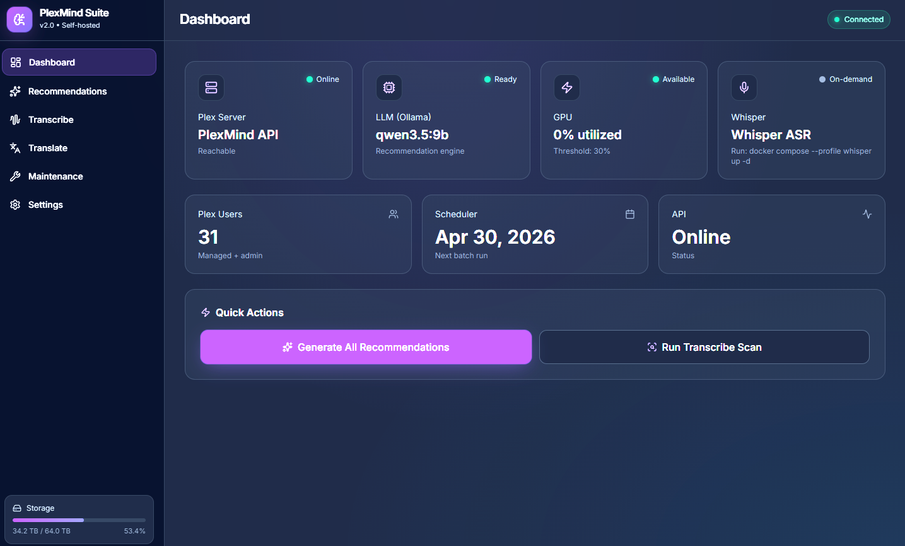

# PlexMind

**Your Plex server, with a brain. On your own GPU.**

[](https://finechainesium.github.io/PlexMind/)
[](templates/PlexMind.xml)
[](LICENSE)

- 🎯 **Picks people actually want.** Each user gets movies and shows matched to *everything* they watch, not just their last title, explained in one line, and delivered straight into Plex.
- 🎙️ **Subtitles for everything.** Whisper writes subtitles for videos that have none.
- 🌍 **In your languages.** A local model translates subtitles, slang and all, checked line by line.
- 🧹 **A tidy library.** Duplicate and replaced subtitles are quarantined, never deleted.

No cloud, no subscription, nothing leaves your server.



## Install

### Unraid

1. Add the template: `https://raw.githubusercontent.com/FineChAInesium/PlexMind/main/templates/PlexMind.xml`
2. Set your Movies and TV folders, and where your llama.cpp and Whisper containers are.
3. Open `http://[unraid-ip]:8000` and **Sign in with Plex**.

No model yet? `./setup.sh --model /mnt/user/appdata/llama-cpp/models` downloads one that fits your GPU.

### Docker Compose

```bash
git clone https://github.com/FineChAInesium/PlexMind.git && cd PlexMind && ./setup.sh
```

`setup.sh` signs you in with Plex, finds your libraries, downloads a model sized for your GPU and starts everything. Then open `http://<server>:8000` and sign in with Plex.

No tokens to copy. No API keys to make.

## Bring any model

PlexMind works with any GGUF llama.cpp can run. The default is **Gemma 4 12B**, which made a third of the translation errors of the runner-up in blind tests. Want to try another? **Model Trial** runs real translation and recommendation work on it on your GPU, next to the current model, and won't let you switch to one that doesn't fit or breaks. [More on models →](docs/MODELS.md)

## Needs

- Plex Media Server
- An NVIDIA GPU with 8 GB or more (12 GB for the default model)
- Docker, or Unraid

## Docs

[Models](docs/MODELS.md) · [Configuration](docs/CONFIGURATION.md) · [Architecture](docs/ARCHITECTURE.md) · [API & command line](docs/API.md) · [Upgrading](docs/UPGRADING.md) · [Security](SECURITY.md) · [Changelog](CHANGELOG.md)

Keep port 8000 on your LAN. PlexMind writes to your media folders and starts its own containers, so don't forward it to the internet.

Made by [@FineChAInesium](https://github.com/FineChAInesium). MIT licensed.
